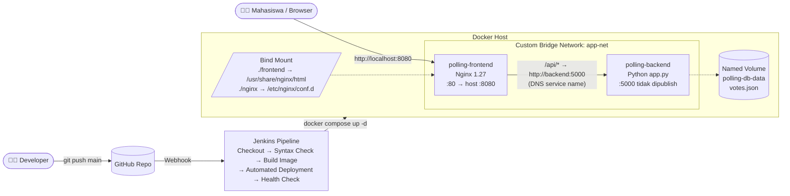

# 🗳️ Campus Polling System

> **Tugas Besar / UTS Cloud Computing — Ujian Chunin**
> Cloud-Native Fullstack Application & Automated CI/CD Pipeline
> **Studi Kasus 7: Sistem Polling / Voting Kampus**

Aplikasi pemungutan suara sederhana untuk kegiatan kampus (Opsi A vs Opsi B).
Fokus proyek ini adalah **containerization** (Docker, Named Volume, Bind Mount, Custom Bridge Network, Docker Compose)
dan **otomatisasi DevOps** (Jenkins Declarative Pipeline + GitHub Webhook).

---

## 👥 Anggota Kelompok

| No | Nama | NIM | Peran |
|----|------|-----|-------|
| 1 | Aizza Kamelia Insani | 101012300341 | Backend API (`app.py`, unit test) & Data Persistence (Named Volume) |
| 2 | Alfreda Luthfi Hermana | 101012300406 | Frontend (`index.html`), Nginx & Docker Compose (Bind Mount, Network) |
| 3 | Bagus Tegar Panutan | 101012330193 | Jenkins CI/CD, GitHub Webhook & Dokumentasi |

---

## 🏗️ Diagram Arsitektur



Versi teks (jika Mermaid tidak tampil):

```
 Browser ──► http://localhost:8080
               │
┌──────────────┼──────────────── Docker Host ───────────────────────────────┐
│  ┌───────────┼──────────── network: app-net (bridge) ──────────────────┐  │
│  │           ▼                                                         │  │
│  │  ┌──────────────────┐   /api/votes → http://backend:5000/votes      │  │
│  │  │ polling-frontend │ ─────────────────────────►┌─────────────────┐ │  │
│  │  │ nginx:1.27-alpine│      (DNS Docker)         │ polling-backend │ │  │
│  │  │ port 80 → 8080   │                           │ python app.py   │ │  │
│  │  └────────▲─────────┘                           │ port 5000       │ │  │
│  └───────────┼─────────────────────────────────────└────────┬────────┘─┘  │
│              │ BIND MOUNT                                   │ NAMED VOLUME │
│     ./frontend/index.html                      polling-db-data:/var/lib/   │
│     ./nginx/default.conf                       polling_data/votes.json     │
└────────────────────────────────────────────────────────────────────────────┘

 git push ──► GitHub ──(webhook)──► Jenkins ──► Checkout → Syntax Check → Build Image
                                               → Automated Deployment → Health Check
```

---

## 📁 Struktur Repository

```
campus-polling-system/
├── backend/
│   ├── app.py              # REST API Python (standard library, tanpa framework)
│   └── Dockerfile          # Image backend (python:3.12-slim, user non-root, HEALTHCHECK)
├── frontend/
│   └── index.html          # UI HTML + Vanilla JS (fetch API), di-bind mount ke Nginx
├── nginx/
│   └── default.conf        # Static server + reverse proxy /api → backend:5000
├── tests/
│   └── test_app.py         # 15 unit test API (dijalankan Jenkins di stage Syntax Check)
├── scripts/
│   ├── test-api.sh         # Demo semua endpoint & error handling via curl
│   └── data-immunity.sh    # Demo data tetap ada setelah `docker rm -f`
├── jenkins/
│   ├── Dockerfile          # Jenkins LTS + Docker CLI + Compose + Python3
│   └── docker-compose.yml  # Menjalankan Jenkins di http://localhost:9090
├── docker-compose.yml      # Definisi deklaratif seluruh stack aplikasi
├── Jenkinsfile             # Declarative Pipeline 5 stage
├── BAHAN_AJAR.md           # Materi belajar kelompok + naskah demo + bank soal
└── README.md
```

---

## 🔌 Dokumentasi REST API

Base URL lewat Nginx: `http://localhost:8080/api` (backend tidak diekspos langsung ke host).

| Method | Endpoint | Fungsi | Sukses | Error |
|--------|----------|--------|--------|-------|
| `GET` | `/health` | Status layanan (untuk Jenkins) | 200 | – |
| `GET` | `/votes` | Perolehan suara Opsi A vs B + riwayat | 200 | – |
| `POST` | `/votes` | Kirim suara `{"voter": "...", "option": "A"\|"B"}` | 201 | 400 (JSON/opsi/nama tidak valid), 409 (sudah vote), 413 |
| `DELETE` | `/votes?index=X` | Hapus catatan suara ke-X | 200 | 400 (index kosong/bukan angka), 404 (index tidak ada) |
| `DELETE` | `/votes?index=all` | Reset semua catatan suara | 200 | – |
| lainnya | – | Endpoint tidak dikenal / method salah | – | 404 / 405 |

Contoh respons `GET /votes`:

```json
{
  "poll":    { "question": "Tema Dies Natalis Fakultas 2026?",
               "options": { "A": "Festival Musik", "B": "Pameran Teknologi" } },
  "results": { "count": { "A": 2, "B": 1 }, "percent": { "A": 66.7, "B": 33.3 },
               "total": 3, "leader": "A" },
  "votes":   [ { "index": 0, "voter": "Budi - 1301220001", "option": "A",
                 "label": "Festival Musik", "timestamp": "2026-11-10T08:40:36+00:00" } ]
}
```

Pertanyaan & label opsi bisa diubah lewat environment variable `POLL_QUESTION`, `OPTION_A`, `OPTION_B` di `docker-compose.yml`.

---

## 🚀 Instalasi & Menjalankan Secara Lokal

**Prasyarat:** Docker Desktop (atau Docker Engine + Compose v2) dan Git.

```bash
git clone https://github.com/alfredalutfi/campus-polling-system.git
cd campus-polling-system

docker compose up -d --build     # build image backend + jalankan stack
docker compose ps                # backend harus (healthy)
```

Buka **http://localhost:8080**.

Perintah berguna:

```bash
docker compose logs -f backend          # lihat log API
docker volume inspect polling-db-data   # detail Named Volume
docker network inspect app-net          # lihat kontainer di network
./scripts/test-api.sh                   # demo API + error handling
./scripts/data-immunity.sh              # demo data immunity
python3 -m unittest discover -s tests -v   # unit test (tanpa Docker)
docker compose down                     # hentikan (data di volume TETAP aman)
docker compose down -v                  # hentikan + HAPUS volume (data hilang!)
```

### Uji Bind Mount
Ubah teks apa pun di `frontend/index.html`, simpan, lalu refresh browser → perubahan langsung tampil **tanpa rebuild image**.

### Uji Data Immunity
```bash
docker rm -f polling-backend        # hapus paksa kontainer backend
docker compose up -d backend        # buat ulang
curl http://localhost:8080/api/votes   # data suara masih lengkap
```

---

## ⚙️ Setup Jenkins CI/CD

### 1. Jalankan Jenkins
```bash
cd jenkins
docker compose up -d --build
docker exec jenkins cat $HOME/jenkins_home/secrets/initialAdminPassword
```
Buka **http://localhost:9090**, tempel password, pilih **Install suggested plugins**, buat user admin.

> **Kenapa `JENKINS_HOME` memakai path `$HOME/jenkins_home` yang sama di host & kontainer?**
> Jenkins memanggil Docker milik host lewat `/var/run/docker.sock`. Bind mount `./frontend` pada
> `docker-compose.yml` diselesaikan oleh Docker host memakai path workspace Jenkins. Dengan path yang
> identik, bind mount menunjuk ke folder yang benar. Pengguna Windows: jalankan dari terminal WSL2.

### 2. Buat GitHub Personal Access Token (PAT)
GitHub → Settings → Developer settings → Personal access tokens → **Tokens (classic)** → Generate new token (classic)
- Note: `Jenkins CI/CD UTS Token`, Expiration 30/90 hari
- Centang **`repo`** dan **`admin:repo_hook`** → Generate → salin token `ghp_...`

Di Jenkins: **Manage Jenkins → Credentials → System → Global → Add Credentials**
- Kind: **Username with password**, Username: username GitHub, Password: token PAT, ID: `github-pat`

### 3. Buat Pipeline Job
**New Item** → nama `campus-polling-system` → **Pipeline** → OK
- ✅ **GitHub project** → URL repo
- Build Triggers: ✅ **GitHub hook trigger for GITScm polling**
- Pipeline → Definition: **Pipeline script from SCM** → SCM: **Git**
  - Repository URL: `https://github.com/alfredalutfi/campus-polling-system.git`
  - Credentials: `github-pat`
  - Branch: `*/main` · Script Path: `Jenkinsfile`
- Save → **Build Now** (build pertama manual untuk memastikan pipeline hijau)

### 4. Pasang GitHub Webhook
GitHub tidak bisa menjangkau `localhost`, jadi buka tunnel publik dengan ngrok:
```bash
ngrok http 9090        # salin URL https://xxxx.ngrok-free.app
```
Repo GitHub → **Settings → Webhooks → Add webhook**
- Payload URL: `https://xxxx.ngrok-free.app/github-webhook/` (wajib diakhiri `/`)
- Content type: `application/json` · Event: **Just the push event** → Add webhook

Selesai! Setiap `git push` ke `main` akan otomatis menjalankan pipeline:

| Stage | Yang dilakukan |
|-------|----------------|
| **Checkout** | Mengambil kode terbaru dari GitHub |
| **Syntax Check** | `py_compile app.py`, 15 unit test, validasi `docker-compose.yml`, cek `index.html` |
| **Build Image** | `docker build` → `campus-polling-backend:<BUILD_NUMBER>` & `:latest` |
| **Automated Deployment** | `docker compose up -d` (volume tidak disentuh → data aman) + reload Nginx |
| **Health Check** | `GET /api/health` dari dalam kontainer Nginx (membuktikan DNS `backend` di `app-net`), retry 15× |

---

## 🎬 Video Demo

🔗 _(tempel link video demo 5–8 menit di sini)_

Isi video: demo UI & API → simulasi Data Immunity (`docker rm -f polling-backend`) → `git push` → Jenkins ter-trigger otomatis → aplikasi ter-update.
